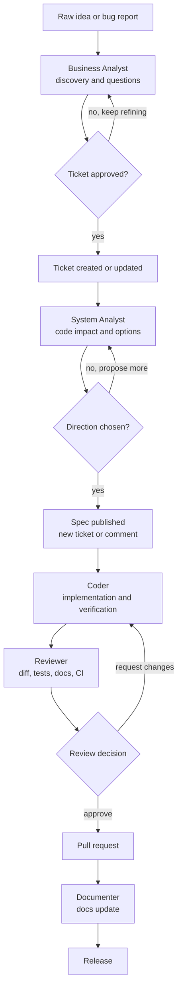
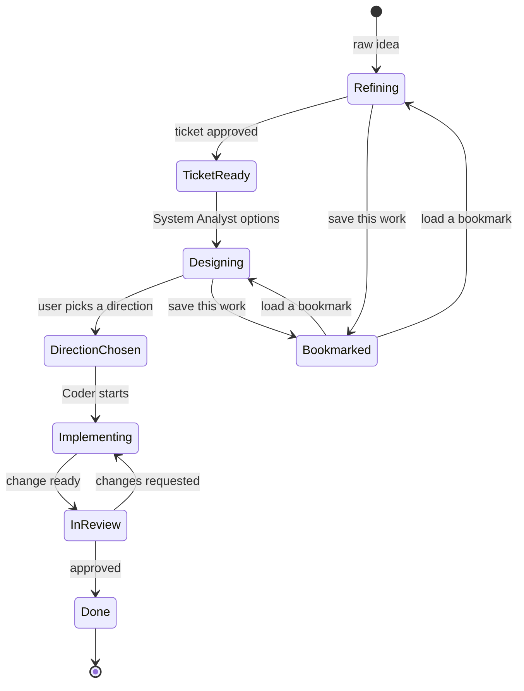
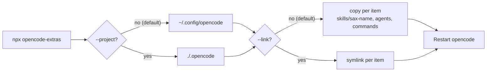

# Flow overview

Who is this for? Anyone who wants the whole picture before reading the
per-agent details. This page shows how a request moves through the toolkit, how
analyst state survives between sessions, and what the installer does to your
configuration directory.

The diagrams are Mermaid blocks; they render on the documentation site and stay
readable as plain text in a terminal.

## Ticket pipeline

A request starts as a raw idea or bug report. Each primary agent hands off to
the next only after its own approval gate; the Reviewer can send work back to
the Coder.

Read-only subagents do the evidence gathering: `sub-ticket-context-reader` and
the docs readers serve the Business Analyst, `sub-code-impact-explorer` serves
the System Analyst, and `sub-pr-context-collector` plus
`sub-pr-test-doc-auditor` serve the Reviewer. They never edit files, so the
pipeline has a single writer per stage.

## Analyst state and bookmarks

Nothing is saved automatically. A bookmark exists only after an explicit
request, and it belongs to the analyst that was active at that moment.

The bookmark operations and their guard rails live in the
[issue-bookmarks skill](../../reference/skills.md#sax-issue-bookmarks); the
storage layout lives in
[state-persistence](../../reference/skills.md#sax-state-persistence).

## Install flow

The installer writes per item, so several skill packs can coexist in the same
opencode configuration directory. `plugins/` is never installed or removed.

After the install, restart opencode once: configurations are read at startup,
and a running session keeps the definitions it loaded. Full options are in
[Getting started](../getting-started.md); uninstall notes are there too.

## Next steps

- Per-agent contracts: [Agent workflows](agents.md).
- Every agent: [Agent reference](../../reference/agents.md).
- Every skill and trigger keyword: [Skill reference](../../reference/skills.md).
